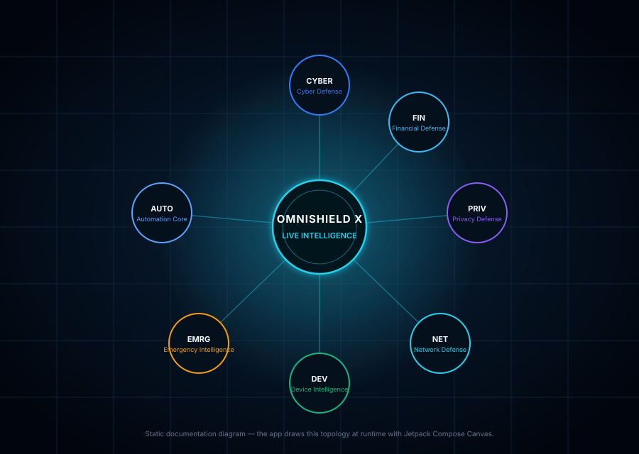

# OMNISHIELD X — Live Intelligence Map

The Live Intelligence Map is the Android app's internal operations map. It is **not** a world map,
not a network topology guess, and not an animation reel: every node, label, number and pulse is
derived from state this device actually produced — DNS blocks the firewall recorded, scans the
security engine stored, battery readings Android reported, VPN state the service published, and
WorkManager jobs that really ran.

Shipped in **AdShield Pro 2.9.0** (schema v4). Open it from the **Intel** tab in the bottom bar.



```
┌──────────────────────────────────────────────────────────────────────┐
│  Module services (real observations only)                            │
│  AdShieldVpnService ─┐                                               │
│  ScanJournalStore   ─┤   IntelligenceEventFactory                    │
│  BatteryTelemetry   ─┼──► (evidence required, or no event)           │
│  WorkManager jobs   ─┤                                               │
│  Settings/DataStore ─┘                                               │
└───────────────────────────────┬──────────────────────────────────────┘
                                ▼
                 IntelligenceRecorder (dedupe + sanitize)
                                ▼
                 IntelligenceRepository (bounded Room store)
                                ▼
     IntelligenceAggregator  ◄── live inputs (VPN, prefs, journal, battery)
                                ▼
       IntelligenceMapViewModel (filters, pause, selection, camera)
                                ▼
            Compose Canvas + glass panels (draw-phase animation)
```

## 1. Architecture

| Layer | File | Responsibility |
| --- | --- | --- |
| Event model | `domain/intelligence/IntelligenceModels.kt` | Module/type/severity catalogue, metrics with provenance, filters, inputs, snapshots |
| Validation & redaction | `engine/intelligence/IntelligenceEventSanitizer.kt` | Rejects evidence-free events, prevents severity downgrades, masks tokens/e-mails/card & phone numbers |
| Event builders | `engine/intelligence/IntelligenceEventFactory.kt` | One function per real observation; every one can return `null` when the observation is unusable |
| Classification | `engine/intelligence/FinancialTargetClassifier.kt` | Attributes a **user-scanned** URL to Financial Defense only when it really is a payment surface |
| Aggregation | `engine/intelligence/IntelligenceAggregator.kt` | Pure derivation of the seven module snapshots, core health, incidents, filters and command metrics |
| Recommendations | `engine/intelligence/IntelligenceRecommendations.kt` | Actions the app can really perform, per module state |
| Ingestion | `data/repository/IntelligenceRecorder.kt` | Single entry point, asynchronous, per-type de-duplication with a bounded key map |
| Storage | `data/repository/IntelligenceRepository.kt`, `data/local/db/IntelligenceEventEntity.kt` | Room table `intelligence_events`, mapper, age + row-count pruning |
| Preferences | `data/local/preferences/IntelligenceMapPreferences.kt` | Separate DataStore file for node positions (never invalidates app settings) |
| Monitor | `engine/intelligence/IntelligenceMonitor.kt` | Process-lifetime battery-threshold and settings-transition observer |
| ViewModel | `ui/viewmodel/IntelligenceMapViewModel.kt` | Combine real flows → aggregator, pause/filter/selection/camera commands |
| UI | `ui/screens/intelligence/IntelligenceMapScreen.kt`, `IntelligenceMapCanvas.kt`, `IntelligencePanels.kt`, `IntelligenceMapGeometry.kt` | Canvas rendering, gestures, glass panels, detail & timeline sheets, pure camera/hit-test maths |
| Background retention | `worker/IntelligenceRetentionWorker.kt` | Daily WorkManager prune/trim, recorded as an Automation event |
| Database | `AdShieldDatabase` v4 + `MIGRATION_3_4` | Non-destructive migration, all existing tables and DNS data untouched |

The pipeline matches the requested shape: **Module services → event repository → processing engine →
live state flow → map UI**.

## 2. Seven modules and where their data comes from

| Map node | Existing subsystem it reads | What raises WARNING / CRITICAL |
| --- | --- | --- |
| Cyber Defense | `SecurityEngine`, `ScanJournalStore` (FILE/APK/non-payment URL scans), `QuarantineManager` | A scan verdict < 24 h: SUSPICIOUS → WARNING, DANGEROUS → CRITICAL |
| Financial Defense | `UrlThreatScanner` results for links the user scanned, attributed by `FinancialTargetClassifier` | Risky payment link < 24 h |
| Privacy Defense | Installed-app audits (`ScanKind.APP_AUDIT`), browser privacy toggles, per-app DNS rules, tracker blocks from the DNS log | Elevation findings < 24 h; DISABLED when both browser shields are off |
| Network Defense | `VpnRuntimeState`, loaded rule count, resolver config, session counters, malware/phishing DNS blocks | Tunnel error → CRITICAL, paused/zero rules → WARNING, user-off → DISABLED |
| Device Intelligence | `BatteryIntelligenceRepository` (real `ACTION_BATTERY_CHANGED` readings) | Temperature ≥ configured threshold → WARNING, +3 °C or hardware health fault → CRITICAL; OFFLINE when the sensor is unsupported |
| Emergency Intelligence | VPN state, rule count, resolver config, `emergencyAllowlistOnly` policy | Lockdown without a tunnel → CRITICAL; lockdown active or readiness < 100 % → WARNING |
| Automation Core | WorkManager results (filter sync, scheduled scan, smart maintenance, cloud backup, retention) + automation settings | One failure in 24 h → WARNING, two or more → CRITICAL; all automations off → DISABLED |
| OMNISHIELD X (core) | All of the above | Overall = worst node state (a single disabled capability never masks a critical one) |

There is no eighth source and no hidden data: the aggregator's input is
`IntelligenceInputs`, built in `IntelligenceMapViewModel` from those flows only.

## 3. Event catalogue

| Code | Module | Default severity | Mitigated by default |
| --- | --- | --- | --- |
| `network.threat_blocked` | Network | WARNING | yes (the block already stopped it) |
| `network.protection_started` / `_stopped` / `filtering_paused` / `resolver_error` / `rules_missing` | Network | INFO / WARNING / WARNING / CRITICAL / WARNING | no |
| `cyber.scan_finding` / `cyber.scan_clean` / `cyber.quarantine_added` | Cyber | WARNING / INFO / NOTICE | clean & quarantine are non-alerting |
| `financial.payment_risk` / `financial.link_clean` | Financial | WARNING / INFO | no |
| `privacy.permission_finding` / `privacy.audit_clean` / `privacy.setting_changed` | Privacy | WARNING / INFO / INFO | no |
| `device.thermal_warning` / `_recovered` / `health_alert` / `telemetry_unavailable` | Device | WARNING / INFO / WARNING / NOTICE | no |
| `emergency.lockdown_on` / `_off` / `readiness_degraded` | Emergency | WARNING / NOTICE / WARNING | lockdown-off is informational |
| `automation.job_ok` / `job_failed` / `setting_changed` | Automation | INFO / WARNING / INFO | no |

Mitigated events still appear in the feed, timeline and as map pulses — they just do not raise the
module into WARNING, because the issue was already handled.

## 4. Honesty rules (enforced in code and tests)

1. **No evidence, no event.** `IntelligenceEventSanitizer` returns `null` when evidence collapses to
   blank; `IntelligenceRepository.record` then writes nothing.
2. **No fabricated activity.** There is no random generator, demo mode, seed event or timer that
   creates events. An idle, disconnected device shows `DISABLED`/`MONITORING` nodes, an empty feed
   and an explicit sentence explaining that no event has been recorded.
3. **No false calm.** Missing battery temperature is OFFLINE with a reason, never `NORMAL`.
4. **No false alarm.** A blocked malware domain is a mitigated event; it does not turn the Network
   node amber after the block already succeeded.
5. **Severity can rise, never fall.** A caller that labels a resolver failure INFO gets CRITICAL
   from the catalogue.
6. **No secrets on labels.** Tokens, bearer headers, `password=…`, e-mail addresses, 9+ digit
   numbers and 32+ character opaque blobs are masked before storage and rendering.
7. **Pause is visual only.** `pauseVisualUpdates()` freezes the displayed aggregate; the recorder,
   VPN service and WorkManager jobs keep running and the header shows how many events arrived while
   paused.

## 5. Interactions

| Gesture | Behaviour |
| --- | --- |
| Drag (one finger) | Pan the camera; `MapCamera.clamped` keeps part of the map on screen |
| Pinch | Zoom around the focal point (0.18×–6× world scale); the world point under the fingers stays fixed |
| Double tap | Animated 2.1× zoom around the tap |
| Tap node / core / marker | Opens the detail sheet for that module or event |
| Long press node | Contextual quick-actions dialog (inspect, centre, open module, first real control) |
| Drag node (layout edit mode) | Moves the node in normalised coordinates; position persists in its own DataStore file |
| Reset camera | Animated return to the fitted view |
| Centre on selected module | Animated camera focus from the command panel or detail sheet |
| Timeline entry tap | Selects the event, closes the sheet and focuses the map on its module/marker |

Tap detection is cancelled by Compose when movement passes the touch slop
(`MapGeometry.TAP_SLOP_PX`), so a pan never opens a panel. During layout editing a node drag consumes its pointer stream; empty-space drags still pan, and leaving edit mode restores the normal gesture set.

## 6. Command panel, timeline and filters

- **Command panel** (collapsible): overall health, seven module chips with live states/alert counts,
  measured command metrics (session queries, blocks, DNS status, privacy/financial/device findings,
  automation runs, stored events), active incidents, build time.
- **Timeline sheet**: live search, module filter, severity filter, time range (15 min → all stored),
  reset filters, event list, and a destructive "clear history" behind confirmation.
- **Node detail sheet**: status, measurements with provenance tags (`measured`, `computed`,
  `configured`, `unavailable`), latest event with evidence, recommended actions, only the controls
  that module really exposes, module history, and "open module".

## 7. Performance and memory

Design constraints and what is actually done:

- **Bounded event store**: `IntelligenceLimits.MAX_STORED_EVENTS = 800`,
  `RETENTION_DAYS = 14`, UI reads at most 600 rows. Pruning runs every 16 inserts and daily via
  WorkManager.
- **Bounded de-duplication map**: 256 keys; DNS blocks cooldown for 10 minutes per domain.
- **Bounded drawing**: 8 nodes, 7 connectors, 7 markers, max 12 tracked / 6 concurrent pulses,
  max 90 grid lines, one radial gradient, no blur or per-frame allocation of brushes/paths.
- **Draw-phase animation**: `frameNanos` and the camera are Compose state read only inside the
  `Canvas` draw lambda. Pan/zoom therefore invalidates drawing, not composition. The `withFrameNanos`
  loop is started only while a real pulse is in flight — an idle map does zero frame work.
- **Lifecycle-aware flows**: `stateIn(WhileSubscribed(5_000))` + `collectAsStateWithLifecycle`, so
  leaving the tab stops all subscriptions and aggregation.
- **Aggregation measured on the CI JVM** (`IntelligenceMapTestSuite.testAggregatorPerformanceBudget`,
  600 stored events + 40 scans + filters + query, 120 iterations after warm-up):

  ```
  IntelligenceAggregator: 600 events, 8 nodes, filters=on → avg=1.610 ms p95=2.230 ms (budget 25 ms avg / 40 ms p95)
  Event feed filter (800 events, query+range): avg=0.681 ms per pass
  ```

  Measured on the GitHub Actions runner (JDK 21, `:app:testDebugUnitTest`, 120 iterations after
  warm-up; run 42182339710). That is roughly 1.6 ms of pure Kotlin per aggregation — about 6 % of a
  60 fps frame budget — with the draw-phase camera keeping composition out of the gesture path.
  Re-run the suite to refresh the numbers; the assertion fails if they regress past the budget.

  The test fails the build if aggregation exceeds those budgets. The numbers above are printed by
  every CI run; copy the latest values from the `JVM unit tests` log step (they are also mirrored in
  `.ci/test.log` on failure). On-device frame timing still belongs to the manual checklist in
  `docs/TESTING.md`, because the JVM cannot measure GPU composition.

## 8. Integration instructions

### Adding a new event source (3 steps)

1. **Observe something real.** From a service, worker or repository, call
   `IntelligenceRecorder.record(draft)` (fire-and-forget) or `emit(draft)` (suspend) with a draft
   built by an `IntelligenceEventFactory` function. Never construct a draft without evidence.
2. **Extend the catalogue** if the new observation is a new kind of occurrence: add an
   `IntelligenceEventType` entry with its owning module and default severity, then a factory
   function. The sanitizer will enforce the module/severity contract automatically.
3. **Add a test.** Assert that the factory returns `null` without evidence and that the aggregator
   reflects the state you expect (`IntelligenceMapTestSuite` has examples for every existing source).

### Wiring an action button

Actions are declared in `IntelligenceAction` (label + whether confirmation is required) and exposed
per module by `IntelligenceAction.forModule`. The screen dispatches them through `onAction`, which
`MainActivity` maps onto existing `AdShieldViewModel` calls. Only add an action if the app already
has the capability, and set `requiresConfirmation = true` for anything that changes protection or
deletes data.

### Database

Schema v4 adds one table. `MIGRATION_3_4` is additive and non-destructive; existing DNS logs,
custom rules, filter sources, daily stats, security scans, storage providers and downloads are
untouched. There is no destructive fallback for upgrades (only `fallbackToDestructiveMigrationOnDowngrade`,
as before).

## 9. Testing and acceptance

JVM suite: `app/src/test/java/com/adshield/pro/IntelligenceMapTestSuite.kt` (CI asserts every
`@Test` in `app/src/test` runs and passes; `tools/audit_capability_tests.py --strict` proves the
capability registry's named tests exist).

| Acceptance criterion | Evidence |
| --- | --- |
| 1. Drag the map smoothly | `detectTransformGestures` → `MapCamera.panBy`; draw-phase state |
| 2. Pinch-to-zoom works | `testGeometryPinchZoomKeepsFocalPointStable` |
| 3. Nodes can be tapped independently | `testGeometryHitTestSelectsNearestNodeAndCore` |
| 4. Selecting a node opens its real details | `NodeDetailSheet` renders `ModuleSnapshot` fields only |
| 5. Actual module events update the map | factory + recorder + repository tests; real publishers in repository/worker/journal |
| 6. Historical events can be inspected | Room store, timeline sheet, `testRepositoryRoundTripPersistsSanitizedEvents` |
| 7. Filters work correctly | `testFiltersMatchModuleSeverityRangeAndQuery` |
| 8. The map does not invent security events | `testSanitizerRejectsEventWithoutEvidence`, `testAggregatorBuildsOnlyFromRealInputs`, `testFactoryNeverEmitsWithoutRealEvidence` |
| 9. Pausing does not disable protection | Pause touches only `MapControls`; no call into the VPN service or recorder |
| 10. Responsive on lower-end devices | `testAggregatorPerformanceBudget` + bounded drawing budget in §7 |
| 11. Existing DNS/settings/data intact | Additive schema migration; existing tests unchanged and green |
| 12. Builds and runs as a real APK | `android-build.yml` compiles, assembles debug + R8 release APK, runs lint/tests, uploads the artifact |

Manual device checklist (also in `docs/TESTING.md`) covers gestures, rotation, pause, an actual
malware block, a payment-link scan and a battery-threshold crossing.

## 10. Known limitations

- **Process-bound observation.** The battery/settings monitor and event recording run only while the
  app process is alive. Android does not allow a normal app to observe battery changes while stopped;
  the map says so rather than implying 24/7 monitoring. DNS protection continues in the VPN service.
- **Detailed DNS logging is optional.** Malware-category blocks always publish an event (no domain
  history is stored beyond the bounded event row), but routine ad/tracker counts depend on the user's
  logging preference and are shown as counters, not events.
- **Financial attribution is deterministic classification**, not a reputation service. It reads the
  URL the user chose to scan and the scanner's existing findings.
- **No geographic or traffic-topology claim.** Nodes represent modules, connectors represent
  "belongs to the core", and pulses represent stored events.
- **Aggregation budget measured on JVM, not on GPU.** See §7; on-device frame timing is a manual check.
